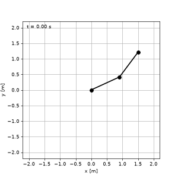
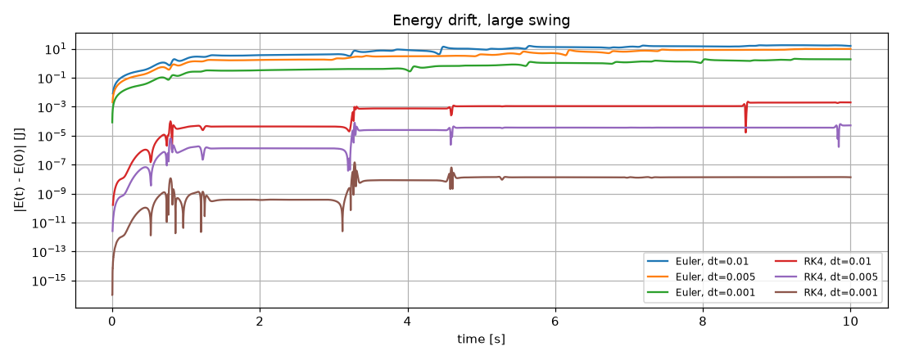

# Double Pendulum Dynamics

A from-scratch simulator for a planar double pendulum, the model behind the acrobot / pendubot swing-up problem (a gymnast pumping energy through the hip). The equations of motion are derived with the Euler–Lagrange equation in SymPy and integrated with a hand-written RK4.

<p align="center"></p>

## What is inside

| Step | Content |
|---|---|
| Modelling | Point masses, massless rods, absolute angles measured from the downward vertical |
| Derivation | Lagrangian $L = K - V$ → Euler–Lagrange equations (SymPy) |
| Dynamics | $\mathbf M(\mathbf q)\ddot{\mathbf q} + \mathbf C(\mathbf q,\dot{\mathbf q}) + \mathbf G(\mathbf q) = \boldsymbol\tau$, numerical functions generated with `lambdify` and cross-checked against a hand-written version |
| Forward dynamics | $\ddot{\mathbf q} = \mathbf M^{-1}(\boldsymbol\tau - \mathbf C - \mathbf G)$ via `np.linalg.solve` |
| Integration | RK4 and explicit Euler. The torque is passed as a function `tau(t, x)`, so controllers can be plugged in |
| Validation | equation residual, energy conservation, comparison with SciPy's DOP853, sensitivity to initial conditions |

## Key results

Parameters: $m_1 = m_2 = 1$ kg, $l_1 = l_2 = 1$ m, $g = 9.81$ m/s², $\boldsymbol\tau = 0$, simulated for 10 s.

Maximum energy drift $\max|E(t)-E(0)|$ for a large swing, $\mathbf x_0 = [2.0,\ 2.5,\ 0,\ 0]$:

| $\Delta t$ [s] | Explicit Euler [J] | RK4 [J] |
|---|---|---|
| 0.01  | 1.8e+01 | 2.2e-03 |
| 0.005 | 9.8e+00 | 7.8e-05 |
| 0.001 | 2.0e+00 | 1.4e-07 |

<p align="center"></p>

- Explicit Euler steadily adds energy. The RK4 error falls roughly as $\Delta t^4$.
- Small oscillation ($\mathbf x_0 = [0.5, 0.3, 0.2, 0.4]$, $\Delta t = 0.005$ s): RK4 stays within about $3\times10^{-7}$ of a DOP853 reference solution computed with tolerance $10^{-12}$.
- Chaos: a $10^{-9}$ rad change in $q_1(0)$ grows to an order-one difference within about 10–20 s.

## Run

```bash
python -m venv .venv && source .venv/bin/activate
pip install -r requirements.txt
jupyter notebook notebooks/double_pendulum_simulator.ipynb
```

Running the notebook regenerates the files in `media/`.

## Possible extensions

- Energy-based swing-up control acting only on $\tau_2$ (acrobot).
- A symplectic integrator (e.g. velocity Verlet) for long-horizon energy behaviour.
- Distributed link inertia instead of point masses.

## License

MIT, see [LICENSE](LICENSE).
